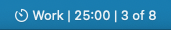
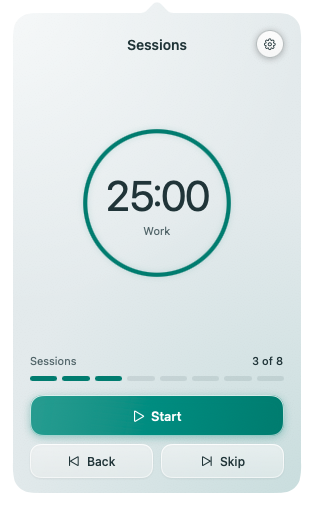
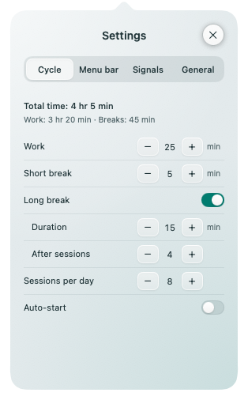

#  Sessions

Sessions is a native Pomodoro timer for the macOS menu bar. Customize work sessions, short and long breaks, and a daily session goal. Choose what appears in the menu bar: an icon, the current phase, remaining time, or session progress.

Pause, resume, reset, or move between phases, and choose manual or automatic transitions. Keep working beyond your daily goal, with optional sounds and notifications when a countdown ends. Timer state and settings are saved locally. The app supports English and Russian, light and dark themes, and launch at login.






## Install

Requires macOS 26 or later (Apple Silicon or Intel).

Run this single command in Terminal:

```sh
curl -fsSL https://raw.githubusercontent.com/sergeevvs/Sessions/main/install.sh | bash
```

It downloads the latest prebuilt release, verifies its checksum and code signature,
installs `~/Applications/Sessions.app`, and launches it. No GitHub account,
GitHub CLI, or Xcode is required.
Downloaded archives, the installer helper, and temporary files are removed when
the command finishes, including on errors. Run the same command to update;
settings and timer progress are preserved. Running Sessions copies are closed
normally before replacement.

## Build from source

With Swift 6.2 or later and Xcode or Command Line Tools installed:

```sh
bash scripts/install-app.sh
```

Run tests with `bash scripts/test.sh`. Maintainers can build the universal release
archive and checksums with `bash scripts/package-release.sh`.
